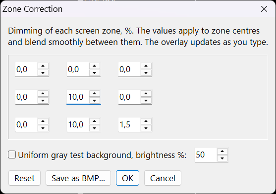
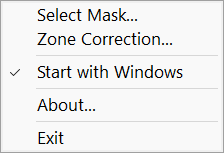

# FixMonitorUniformity

A small free Windows utility that evens out uneven monitor backlighting in software.

Many monitors have areas that are brighter than the rest: a glowing corner, a lighter edge, a bright band. FixMonitorUniformity places a transparent, click-through black overlay over the screen and darkens only those areas, so the whole picture looks more even.

The program has no main window: it runs in the background and is controlled from its **icon in the system tray** (notification area). Right-click the icon to open the menu.

## Features

- **Zone Correction**: set the dimming for each of 9 screen zones (3x3 grid). The zones blend smoothly into each other, with no visible borders or banding. Changes preview live, and a uniform gray test background helps you see what's left to fix.
- **Custom mask**: for precise correction, load your own grayscale BMP mask (white = no change, darker = more dimming). See [Custom mask](#custom-mask).
- **Works everywhere**: in all programs, including the browser and YouTube.
- **Practically no impact on performance or power consumption**: the overlay is a static image composed by Windows itself; the program does no work while it runs.
- **Fullscreen 3D games**: the overlay switches off automatically while an exclusive fullscreen game runs, so it doesn't reduce game performance.
- **Screenshots**: the overlay doesn't appear in screenshots or screen recordings.
- Optionally starts with Windows.

## Limitations

- **Brightness only.** The utility corrects uneven *brightness* of the backlight. Color defects, such as a greenish corner or a pinkish spot, unfortunately can't be fixed due to technical limitations.
- It can only darken bright areas, never brighten dark ones. The overall brightness is reduced slightly where the correction is applied.
- The correction covers the primary monitor only.

## System requirements

- Windows 11 or Windows 10 (version 2004 or later recommended).

## Download

Download `FixMonitorUniformity.exe` from the [latest release](https://github.com/Aleksid1/FixMonitorUniformity/releases/latest). No installation is needed: it's a single portable file, digitally signed.

## Usage

1. Run `FixMonitorUniformity.exe`. Put it in a permanent folder first if you plan to use **Start with Windows**.
2. At first start choose **Zone Correction** (recommended) or **Mask File**.
3. In Zone Correction, turn on the gray test background and increase the dimming in zones that look brighter until the screen looks even. Press **OK**.



All settings are available later from the tray icon menu: **Select Mask...**, **Zone Correction...**, **Start with Windows**, **About...**, **Exit**.



Settings are stored in `%LOCALAPPDATA%\FixMonitorUniformity\`.

## Custom mask

Instead of zones, you can draw your own mask in an image editor. A mask is a grayscale picture of your screen: **white** areas stay unchanged, **gray** areas are darkened. The darker the gray, the stronger the dimming.

How to make one:

1. Create a white image exactly the size of your screen resolution, for example 1920 x 1080.
2. In Photoshop, take a brush with color 241, 241, 241, Brightness Jitter 98% (dithering, to avoid visible banding) and diameter 555 px.
3. Paint over the areas that are too bright on your monitor.
4. Save as a 24-bit BMP.
5. In the tray menu choose **Select Mask...** and open the file.

If the correction is too weak or too strong, edit the mask and load it again.

## Privacy

FixMonitorUniformity doesn't collect any personal data and shows no ads.

## Building from source

Written in Free Pascal / [Lazarus](https://www.lazarus-ide.org/). Open `FixMonitorUniformity.lpi` in Lazarus, or build from the command line:

```
lazbuild --build-all FixMonitorUniformity.lpi
```

## License

[MIT](LICENSE)
